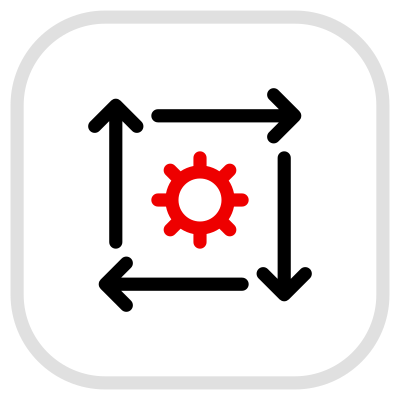
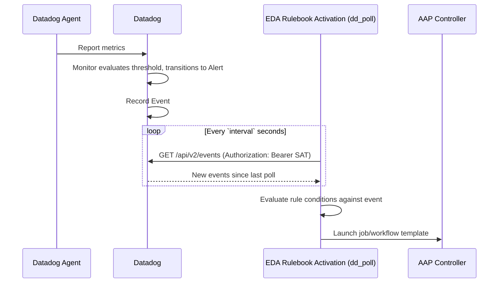
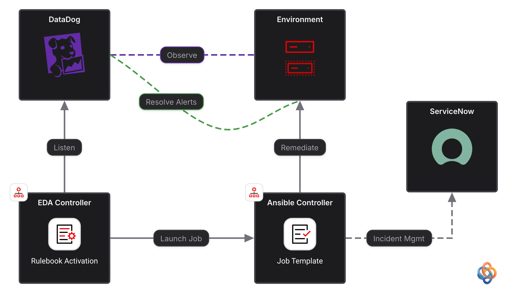
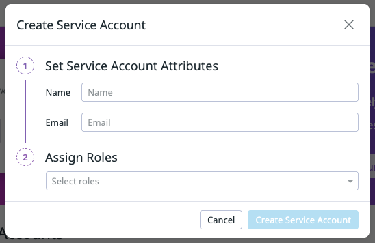
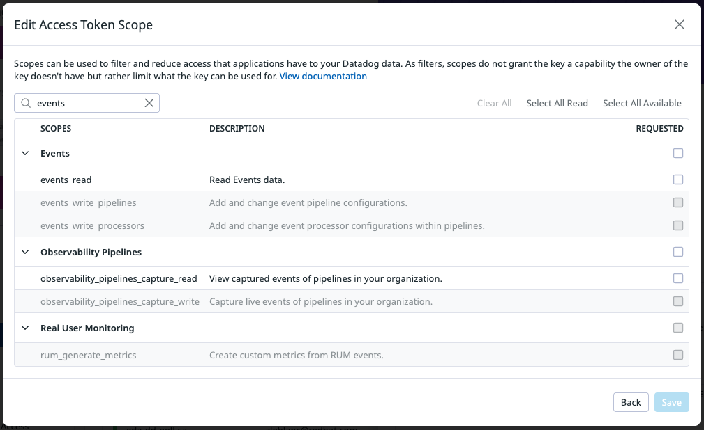
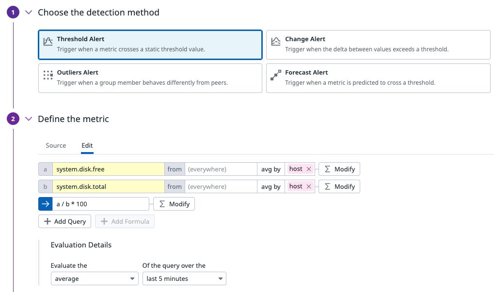
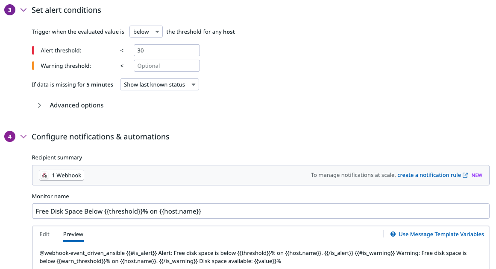
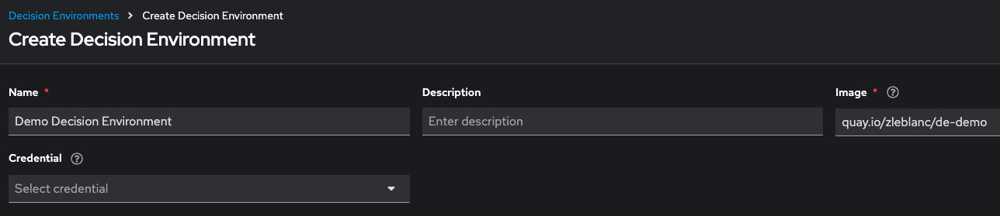
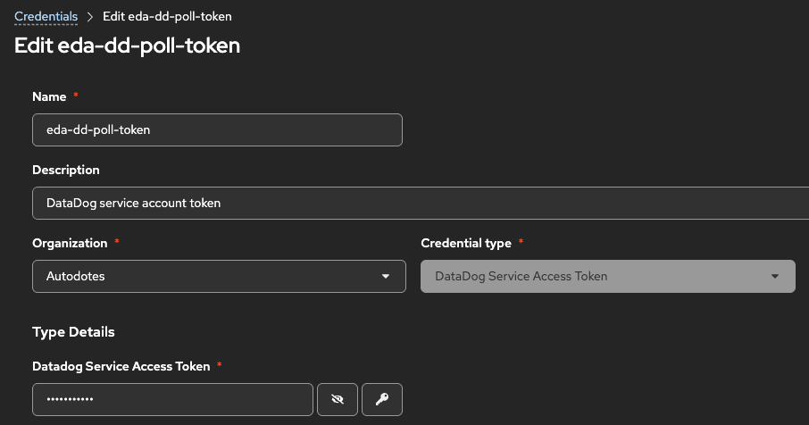
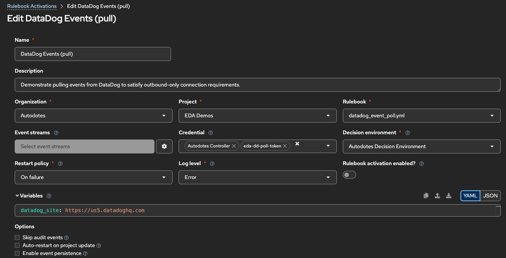

# Polling Datadog Events with Event-Driven Ansible

<p align="center">
  
  <picture>
    <source media="(prefers-color-scheme: dark)" srcset=".attachments/arrow-dark.svg">
    
  </picture>
  
</p>

The [Datadog + EDA integration](datadog_eda_integration.md) in this repo uses the **event stream** (push/webhook) pattern: **Datadog initiates the connection**, `POST`ing alerts to an AAP-managed endpoint, so AAP must be reachable *inbound* from Datadog. That pattern is the right default, but some environments don't permit inbound access to AAP at all (e.g. AAP sits behind a firewall with an outbound-only / egress-only policy, has no publicly reachable endpoint, or inbound changes require lengthy change control) — while still allowing AAP to make **outbound** calls out to the Datadog API.

This guide covers that alternative: a **polling** source plugin, `zjleblanc.eda.dd_poll`, that runs inside the rulebook activation and **initiates the connection the other way** — AAP periodically calls out to the [Datadog Events API](https://docs.datadoghq.com/api/latest/events/) to pull new events. Datadog never needs to reach AAP; AAP only needs outbound HTTPS access to Datadog. Use this pattern specifically when inbound traffic to AAP isn't allowed but AAP can reach Datadog. It's a locally-maintained, security-hardened plugin, authenticating with a Datadog **Service Access Token** instead of a static API key / Application key pair.

## Table of Contents

- [Source Code](#source-code)
- [End-to-end flow](#end-to-end-flow)
- [Tech Stack](#tech-stack)
- [Setup](#setup)
- [The rulebook explained](#the-rulebook-explained)
- [Triggering a test alert](#triggering-a-test-alert)
- [Troubleshooting](#troubleshooting)
- [References](#references)

## Source Code

- [Rulebook](../rulebooks/datadog_event_poll.yml)
- [`zjleblanc.eda` collection / `dd_poll` plugin source](../collections/zjleblanc/eda/extensions/eda/plugins/event_source/dd_poll.py)
- [Galaxy listing](https://galaxy.ansible.com/ui/repo/published/zjleblanc/eda/)

The workflow and job templates associated with the remediation are in two external repositories:
- [Configuration-as-Code](https://github.com/zjleblanc/ansible-cac/tree/main/config/aiops)
- [Ansible Playbooks](https://github.com/zjleblanc/ansible-cloud-mgmt/tree/master/playbooks)

## End-to-end flow

1. The **Datadog Agent** runs on a monitored host and continuously reports metrics/logs/traces to Datadog.
2. A **Datadog Monitor** evaluates those metrics against a threshold (for example, disk space below 30%) and transitions to an **Alert** state. Datadog automatically records this transition as an **Event** — no webhook configuration is required for the event to exist.
3. The **`dd_poll`** source plugin, running inside the EDA **rulebook activation**, is the one that initiates the connection: it calls `GET /api/v2/events` outbound against the Datadog API on an interval, authenticating with a **Service Access Token** presented as a bearer credential. Datadog never connects to AAP. The plugin only requests events newer than its last successful poll (with a small overlapping lookback window) and de-duplicates by event ID.
4. Each new event is put on the rulebook's event queue and evaluated against the rules in [`rulebooks/datadog_event_poll.yml`](../rulebooks/datadog_event_poll.yml) — conditions match directly against event fields (`event.title`, `event.hostname`, etc.), with no `event.payload` wrapper.
5. When a condition matches, the rule's action launches an AAP **job template** or **workflow template** to remediate the issue — optionally creating/updating a ServiceNow incident along the way, and closing the loop once resolved.

### Mermaid

### Lemma


## Tech Stack

- Datadog (Agent + Monitors + Events API + Service Access Tokens)
- `zjleblanc.eda` Ansible collection (`dd_poll` event source plugin), published to Ansible Galaxy
- Ansible Automation Platform Controller
- Event-Driven Ansible Controller
- Optional: ServiceNow, AWS, or whatever infrastructure the remediation playbook targets

## Setup

### Install and configure the Datadog Agent

Install the [Datadog Agent](https://docs.datadoghq.com/agent/) on each host you want to monitor. Any integration the Agent supports (disk, CPU, memory, process, network, log collection, APM, etc.) can ultimately drive an EDA remediation — the Agent doesn't need any special configuration for this integration beyond what a normal Datadog check requires. This step is identical to the [event stream guide](datadog_eda_integration.md#install-and-configure-the-datadog-agent).

### Create a Datadog Service Account and Service Access Token

Datadog's current recommended authentication model for automation is a **Service Access Token (SAT)** tied to a **service account**, rather than a personal Application Key. SATs are scoped, support expiration policies, and remain valid independent of any individual user's access.

1. In Datadog, hover over your user icon and go to **Organization Settings > Service Accounts** and click **+ New Service Account**.

    | Field | Value |
    | --- | --- |
    | Name | `eda-dd-poll-sa` |
    | Email | `zach@example.com` |
    | Roles | `DataDog Read Only Role` |
   
   

2. Open the new service account's details page, and under **Access Tokens**, click **+ New Token**.
3. Configure the token:

    | Field | Value |
    | --- | --- |
    | Name | `eda-dd-poll-token` |
    | Expiration Date | _Choose desired lifespan_ |
    | Select Scopes | `events_read` (minimum req'd) |

   

4. Click on the new Service Account and **+ New Token** and **copy the token value immediately** — it is only shown once and starts with the `ddsat_` prefix. Store it in a secrets manager; you'll paste it into an AAP credential in the [AAP Credential](#aap-credential) step below.

> This plugin also supports the legacy v1 Events API (static `api_key` + `app_key`) for environments that haven't migrated yet, but this is **deprecated** — Datadog has marked Application Keys as a legacy authentication method. Use the SAT approach above for any new integration.

### Create a Datadog Monitor

In the Datadog portal, navigate to **Monitors > New Monitor** and choose the monitor type that matches what you want to observe (Metric, APM, Log, Process, etc.). For the disk-space example used by this repo's rulebook, create a **Metric Monitor**:

| Config | Value |
| --- | --- |
| Monitor type | Metric |
| Detection method | Threshold Alert |
| Define the Metric > Source | `avg:system.disk.free{*} by {host} / avg:system.disk.total{*} by {host} * 100` |
| Define the Metric > Evaluation Details | Evaluate the `average` of the query over the `last 5 minutes` |
| Data source scope | Filter to the host(s) or tags of interest |
| Set alert conditions > Alert threshold | `< 30` e.g. (below 30% free) |
| Configure notifications & automations > Monitor name | **Free Disk Space Below 30%** |

⚠️ **Monitor name** is important — the rulebook's condition matches on `event.title`. If you change the title, update the condition in the rulebook to match.

Unlike the event stream pattern, **no webhook or notification recipient is required here**. Datadog records an Event every time a Monitor changes state regardless of its notification configuration — `dd_poll` picks these up directly from the Events API on its next poll.




Key event fields the rulebook consumes:

| Field | Used for |
| --- | --- |
| `event.title` | Matching the rule condition (`is match("Free Disk Space Below", ...)`) |
| `event.hostname` | Throttle grouping and the `_host` extra var passed to the remediation workflow |
| `event.id` | Included in the ServiceNow incident description/comments to reference the Datadog event |

### EDA Decision Environment

Unlike the event stream pattern, this integration **requires** the `zjleblanc.eda` collection (which provides the `dd_poll` plugin and its `aiohttp` Python dependency) to be present in the decision environment used by the activation. The default/built-in AAP decision environment does **not** include it.

1. Build (or request from your platform team) a decision environment image whose `execution-environment.yml` includes:

    ```yaml
    ...
    dependencies:
      galaxy:
        collections:
          - name: zjleblanc.eda
          ...
    ```

2. Push the resulting image to your container registry, then register it in AAP: navigate to **Automation Decisions > Infrastructure > Decision Environments** and click **Create Decision Environment**, pointing **Image** at your custom image.

   

> This repo doesn't own the decision environment build — it assumes `zjleblanc.eda` has already been published to Galaxy and is simply listed as a collection dependency in whichever decision environment definition your platform team maintains.

### EDA Project

Point an AAP **Project** at this git repository (or your fork) so the rulebook is available to activations.

| Config | Value |
| --- | --- |
| Name | EDA Demos Project |
| SCM type | Git |
| SCM URL | https://github.com/zjleblanc/ansible-eda-demos.git |
| Credential | _Not required for public repo_ |
| Verify SSL | ✅ |

### AAP Credential

The Datadog Service Access Token must reach the `dd_poll` plugin as the `DD_BEARER_TOKEN` environment variable on the rulebook activation — **never** paste it directly into the rulebook or a plugin argument. The clean way to do this in AAP is a custom **Credential Type** with an environment-variable injector, attached to the activation.

1. Navigate to **Automation Decisions > Infrastructure > Credential Types** and click **Create credential type**.
2. Configure the **Input configuration**:

    ```yaml
    fields:
      - id: dd_bearer_token
        type: string
        label: Datadog Service Access Token
        secret: true
    required:
      - dd_bearer_token
    ```

3. Configure the **Injector configuration**:

    ```yaml
    env:
      DD_BEARER_TOKEN: '{{ dd_bearer_token }}'
    ```

4. Save the credential type (e.g. name it `Datadog SAT`), then navigate to **Credentials > Create credential**, select the `Datadog SAT` type, and paste the SAT value created in the [Datadog Service Account](#create-a-datadog-service-account-and-service-access-token) step.

   

5. This credential will be attached directly to the rulebook activation in the next step — AAP injects `DD_BEARER_TOKEN` into the activation's running process, where `dd_poll` reads it.

### EDA Rulebook Activation

Navigate to **Rulebook Activations > Create rulebook activation**:

| Config | Value |
| --- | --- |
| Name | Datadog Event Poll |
| Project | EDA Demos Project |
| Rulebook | `datadog_event_poll.yml` |
| Decision environment | The custom DE from the [EDA Decision Environment](#eda-decision-environment) step above |
| Credentials | `Datadog SAT` credential created above |
| Controller token | Token |
| Restart policy | On failure |
| Rulebook activation enabled? | _Checked_ |

Note there is **no Event Streams mapping** step here, unlike [`datadog_event_stream.yml`](../rulebooks/datadog_event_stream.yml) — the `dd_poll` source plugin itself establishes the connection to Datadog, so the `sources` entry in the rulebook is used as-is, not swapped out at activation time.



### AAP Resources

The rulebook launches the same downstream automation described in the [disk space remediation lab](expand_disk_space.md#the-workflow) — a workflow with steps for creating a ServiceNow incident, resizing storage, and updating the incident. Reuse that workflow (`EDA // Remediation Workflow // Disk Space`) and its credentials/inventory rather than duplicating them; only the **event source** differs between the event-stream and polling demos, not the remediation.

## The rulebook explained

[`rulebooks/datadog_event_poll.yml`](../rulebooks/datadog_event_poll.yml):

```1:22:rulebooks/datadog_event_poll.yml
---
- name: Poll DataDog Events API for Event-Driven Ansible
  hosts: all

  sources:
    - name: DataDog Event Source
      zjleblanc.eda.dd_poll:
        site: "{{ datadog_site }}" # Optional (view module docs - site defaults to api.datadoghq.com)
        interval: 15
        lookback_minutes: 5
```

Unlike the event stream rulebook, the `sources` entry here is **not** a placeholder — `zjleblanc.eda.dd_poll` is a real, running source plugin for both local testing and AAP activation. The Datadog bearer token is deliberately absent from the plugin arguments; it's read from the `DD_BEARER_TOKEN` environment variable injected by the AAP credential configured on the activation.

```48:52:rulebooks/datadog_event_poll.yml
    - name: Catch 'em All
      condition: event.id is defined
      action:
        debug:
          msg: "{{ event }}"
```

**Catch 'em All** matches every polled event and dumps it via `debug`. It's useful while first wiring up the activation — enable it to confirm events are flowing (and see the full field set an event carries) before layering on real remediation rules, then disable or remove it once you're done.

## Triggering a test alert

### 1. Requirements
Before sending the request, ensure you have your **Datadog API Key**:
* Find or create your key by navigating to **Organization Settings > API Keys** in your Datadog dashboard.

### 2. Choose Your Endpoint Region
* **US1:** `https://datadoghq.com/api/v1/events`
* **US3:** `https://us3.datadoghq.com/api/v1/events`
* **US5:** `https://us5.datadoghq.com/api/v1/events`
* **EU:** `https://datadoghq.eu`

### 3. Send the Test Event via cURL
Run the following `curl` command in your terminal, replacing `<YOUR_API_KEY>` with your actual Datadog key:

```bash
curl -X POST "https://<dd-region>/api/v1/events" \
-H "Content-Type: application/json" \
-H "DD-API-KEY: <YOUR_API_KEY>" \
-d '{
  "title": "Test Integration Alert Event",
  "text": "This is a dummy event generated to test a 3rd-party integration polling mechanism.",
  "priority": "normal",
  "tags": [
    "environment:test",
    "integration:polling-test"
  ],
  "alert_type": "warning"
}'
```

### 4. Verify in Datadog
1. Open Datadog and navigate to the **Event Explorer**.
2. Look for the title **"Test Integration Alert Event"**.
3. Once visible, run your 3rd-party polling tool. The integration should successfully fetch this new event payload through its normal extraction cycle.


## Troubleshooting

| Symptom | Likely cause |
| --- | --- |
| Activation fails to start with an import error for `aiohttp` or `zjleblanc.eda` | The decision environment doesn't have the `zjleblanc.eda` collection (and its `aiohttp` dependency) installed; rebuild the DE and confirm the collection appears in `ansible-galaxy collection list` inside the image |
| Activation log shows `dd_poll requires either a bearer token...` | The `Datadog SAT` credential isn't attached to the activation, or its injector doesn't set `DD_BEARER_TOKEN` — recheck the [AAP Credential](#aap-credential) configuration |
| Datadog API calls return `403` | The Service Access Token's scopes don't include `events_read` — edit the token's scopes (or create a new one) in Datadog |
| No events ever appear, even with `Catch 'em All` enabled | Confirm the Monitor actually transitioned to Alert in Datadog's own event stream UI; also confirm the activation is actually running (not restarting on a crash loop) |
| Events appear late | Increase `lookback_minutes` slightly, or decrease `interval` for faster polling (at the cost of more API calls) |
| Duplicate workflow launches for the same alert | Confirm the `throttle` block is present on the rule, and that `group_by_attributes` matches a stable field (`event.hostname`) |

## References

- [Rulebook: `rulebooks/datadog_event_poll.yml`](../rulebooks/datadog_event_poll.yml)
- [Plugin source: `zjleblanc.eda.dd_poll`](../collections/zjleblanc/eda/extensions/eda/plugins/event_source/dd_poll.py)
- [Event stream alternative: `docs/datadog_eda_integration.md`](datadog_eda_integration.md)
- [Datadog Events API docs](https://docs.datadoghq.com/api/latest/events/)
- [Datadog Service Access Tokens](https://docs.datadoghq.com/account_management/service-access-tokens/)
- [Datadog blog: Modernize Datadog API authentication with scoped credentials](https://www.datadoghq.com/blog/datadog-api-authentication/)
